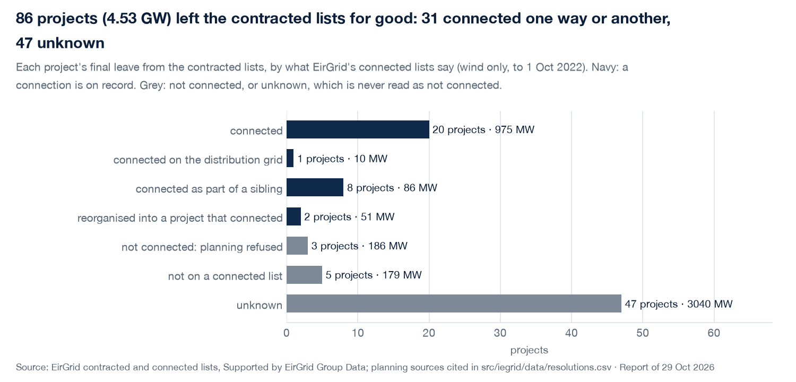
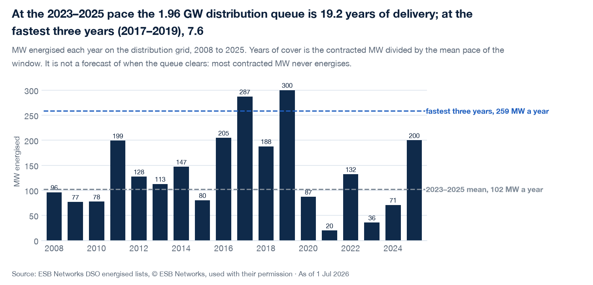
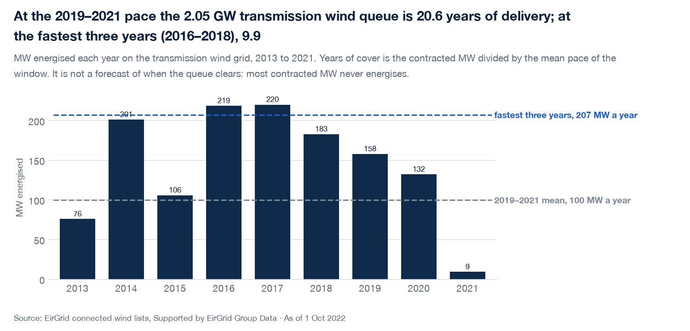
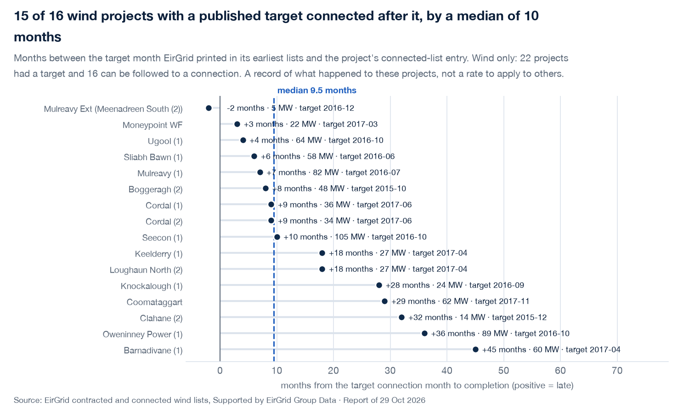
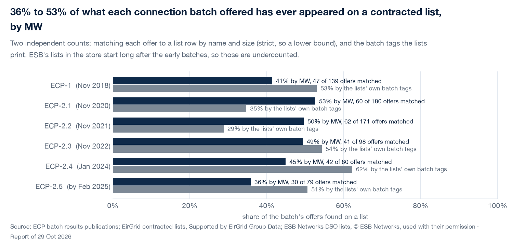
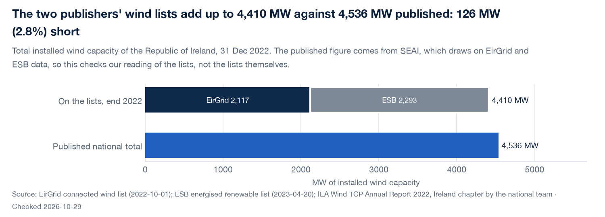

# ie-grid-pipeline

A point-in-time record of Ireland's grid connection queue: how much generation is waiting to connect, what moved, what is stuck, and where.

## What this is

Ireland's two grid companies publish lists of the projects that have signed a connection agreement but are not yet connected: EirGrid for the transmission grid and ESB Networks for the distribution grid. The lists are PDFs, replaced each time a new edition comes out, so the history disappears unless someone keeps it. This project keeps it. Every edition is stored as published, with its own as-of date, its publication time and the time it was fetched. Editions back to 2015 come from the Internet Archive.

From that store it builds a weekly report (a PDF, a JSON file and a static web page) and the charts below. It does not forecast. The one "years of delivery" figure is a ratio, labelled as such.

## How it works

1. **Ingest.** Download every current list, hash it, record when it was published.
2. **Load.** Parse each edition and accept it only if it ties to itself: the same project references as the page text and total MW within 1 MW of the printed total.
3. **Place.** Put each project in a county from the connection-batch results, a cited table or OpenStreetMap substations, and on the map at its connection substation.
4. **Report.** Build the weekly report from the store; every number on the page and in the charts comes from that report file.
5. **Check.** Tests tie every edition to its printed total, and the site's tests check every number on the page against the report.

## Results

From the report of 29 October 2026, with lists as of 5 August 2026 (transmission) and 1 July 2026 (distribution). Every chart is drawn from the report with `uv run python -m iegrid.readme_charts`.

**What is waiting.** 16.66 GW has signed to connect and is not yet energised; solar is a third of it.

**What moved.** 2025 was the biggest year for joining the transmission lists.

**What is stuck.** Compared at the same age, the oldest connection batch connected fastest, and no later batch has passed 1 % three years after its results.

**Where.** Each circle is a connection substation, sized by the MW waiting there, on OpenStreetMap's lines. Blue circles are 20 km or more from the 220, 275 and 400 kV network.

**How fresh the lists are.** EirGrid posts its lists about five days after their as-of date, ESB Networks about a month, so the distribution side runs a month behind.

**What became of the projects that left.** 86 projects left the contracted lists for good. Where a connected list exists, it says what happened; where it does not, the outcome stays unknown rather than being read as "not connected".

**How long the queue would take at past paces.** The contracted MW divided by the MW energised each year. It is not a forecast, because most contracted MW never energises.

**Promises against delivery.** Of the wind projects whose target connection month EirGrid printed, 15 of 16 connected after it.

**From offer to list.** Between a third and a half of what each connection batch offered has ever appeared on a contracted list, counted two independent ways.

**A check against a published total.** The two publishers' wind lists add up to within 3 % of the national total published for the end of 2022.

**How much of it counts as capacity.** Under the capacity auction's de-rating factors, about 2.1 GW of the 12 GW with a published factor counts as firm capacity, and gas turbines are about 70 % of that.

## How to run

    uv sync
    ops/weekly.sh                      # the weekly run: new lists in, report out, page rebuilt

Step by step:

    uv run python -m iegrid.ingest         # fetch every current list into data/
    uv run python -m iegrid.load           # parse what is new, each edition tied to its printed total
    uv run python -m iegrid.counties       # place projects in counties
    uv run python -m iegrid.grid           # OpenStreetMap lines and substations (once, or to refresh)
    uv run python -m iegrid.report         # the weekly report: data/reports/<date>T<HHMM>.json and .pdf
    uv run python -m iegrid.readme_charts  # the charts above, into docs/img/
    uv run pytest

The dashboard is a static Next.js page built from the report, served locally only:

    cd site && pnpm install
    pnpm test && pnpm build && pnpm serve   # http://127.0.0.1:3100

## Analysis layers

Nine studies built on the record, each with its own README, tests and expected numbers in `docs/layers/`: what became of the projects that left, delivery pace, target slippage, the offer-to-list funnel, an errata ledger of where the lists disagree, ESB's older lists, the external check against a published wind total, sourced resolutions of open questions, and firm capacity under the auction's de-rating factors. `docs/layers/00-decisions.md` records which studies were built, which were tested and dropped, and why.

## Layout

| Path | What it holds |
|---|---|
| `src/iegrid/` | Ingest, parse, load, place, report, charts and the layer modules |
| `src/iegrid/data/` | Small cited tables: stations, external checks, resolutions |
| `tests/` | pytest; every edition is tied to its printed total |
| `site/` | The Next.js dashboard; its tests check every number against the report |
| `ops/` | The weekly run |
| `docs/` | The reading guide, the build spec, the layers and the chart images |
| `data/` | Raw PDFs, the DuckDB store and the reports (not in git) |

## Documents

`docs/README.md` is the reading guide: what each document is, what the internal stage codes mean, and how the weekly run, the report, the site and the charts fit together. `docs/spec.md` is the build specification and `PARKING.md` the open decisions.

## Data and licence

Code: MIT (`LICENSE`). The lists belong to their publishers. ESB Networks and EirGrid have each confirmed permission to use their lists here; credit lines stay on every chart and the full credits are in `NOTICE`. Grid lines and substations are © OpenStreetMap contributors (ODbL). The raw PDFs and the store are not in the repository.

## Glossary

- **Transmission and distribution**: the high-voltage grid EirGrid runs (110 kV and up) and the local grid ESB Networks runs. A project connects to one or the other.
- **Contracted**: has a signed connection agreement but is not yet connected.
- **Energised, or connected**: exporting to the grid; it then leaves the contracted list.
- **ECP, and a batch**: the Enduring Connection Policy, under which projects apply in yearly batches (ECP-1, ECP-2.1 and so on) and get their connection offers together.
- **MEC**: maximum export capacity, the MW a project may export. The lists are added up in MEC.
- **Edition**: one published version of a list. Each has an as-of date (what it describes) and a publication date (when it went up).
- **As-of date**: the date a list describes, which can be weeks before it is published.
- **Point-in-time**: keeping every edition with its dates, so any past state of the queue can be read back.
- **Backbone**: the 220, 275 and 400 kV lines that carry power across the island.
- **De-rating factor**: the share of a technology's MW the capacity auction counts as reliably available.
- **Townland**: the smallest named unit of land in Ireland, used to place a station when nothing better is known.
