# ie-grid-pipeline

Ireland has a long queue of power projects waiting to connect to the grid. This project keeps a record of that queue: how much is waiting, what moved, what is stuck, and where.

The two grid companies, EirGrid and ESB Networks, publish lists of these projects as PDFs. Each new list replaces the last, so the history disappears unless somebody keeps it. This repository stores every list it can find, back to 2015, and turns them into a weekly report, a web page and the charts below. It only records what happened and makes no forecasts.

## The main findings

- **16.57 GW is waiting.** That is the capacity that has signed to connect but is not connected yet. Solar is a third of it.
- **Being in the queue doesn't mean being built soon.** 15 of the 16 wind projects we could check connected after their target date.
- **Only part of the queue counts towards keeping the lights on.** Under the capacity auction's rules, 2.0 to 2.1 GW of the 12.0 GW that has a published rating counts, and more than half of that is gas.
- **So how much gets built matters more than the queue's size.** The grid operators' own reports have mostly expected more new plant than has arrived.

Figures are from the report of 30 October 2026, using lists dated 5 August 2026 (EirGrid) and 1 October 2026 (ESB Networks). They change as new lists arrive.

## Words used below

- **Contracted:** the project has signed a connection agreement but isn't connected yet.
- **Energised:** the project is connected and can export power.
- **Transmission and distribution:** the large national grid, run by EirGrid, and the local grid, run by ESB Networks.
- **Connection batch (ECP):** a group of projects that applied together and got their offers together, such as ECP-1 or ECP-2.1.
- **MW and GW:** units of capacity. 1 GW is 1,000 MW. The lists count the most power each project may export.

## How much is waiting?

> **Credit for all charts.** Every chart below is drawn from the lists of EirGrid (Supported by EirGrid Group Data) and ESB Networks (© ESB Networks), both used with their permission; neither endorses this work. The images carry no credit text, so it is given here, and each chart's `.tex` caption in `docs/img/` repeats it with the as-of date.

Solar is the largest group, followed by gas and oil, wind, and hybrid projects.

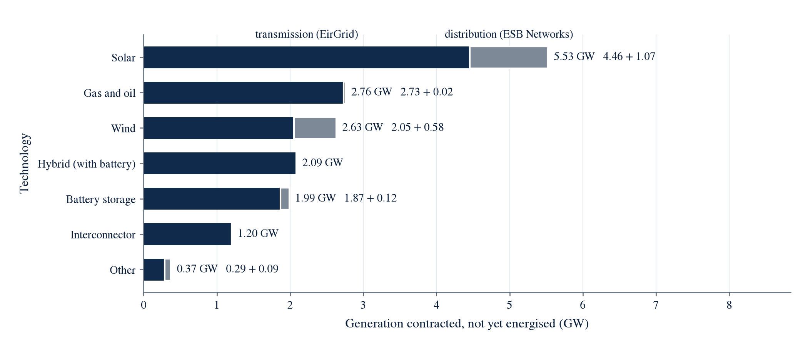

*Figure: 16.57 GW has signed to connect; solar is 33% of it. Source: EirGrid contracted lists, Supported by EirGrid Group Data; ESB Networks DSO lists, © ESB Networks, used with their permission; transmission list as of 5 Aug 2026, distribution list as of 1 Oct 2026; as of 2026-10-01.*

The transmission queue was small until about 2020, and nearly all its growth since has been non-wind. Wind stands at 2.05 GW and everything else at 12.64 GW.

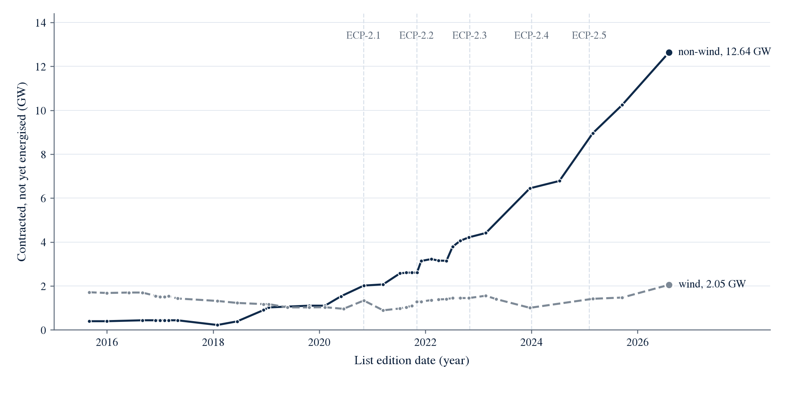

*Figure: Non-wind grew from 0.40 GW in 2015 to 12.64 GW; wind is 2.05 GW. Source: EirGrid TSO contracted wind and non-wind lists, read from eirgrid.ie and the Internet Archive; Supported by EirGrid Group Data; as of 2026-08-05.*

## What is moving?

2025 was the biggest year for joining the transmission lists: 4.28 GW joined and 0.33 GW left.

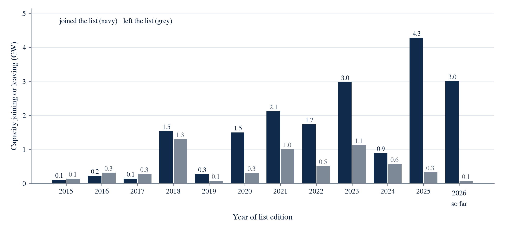

*Figure: 2025 was the biggest year for joining: 4.28 GW joined and 0.33 GW left. Source: EirGrid TSO contracted lists, Supported by EirGrid Group Data; as of 2026-08-05.*

86 projects have left the lists for good. 36 connected in some form and 42 are unknown. An unknown stays unknown here: it is never counted as "not connected".

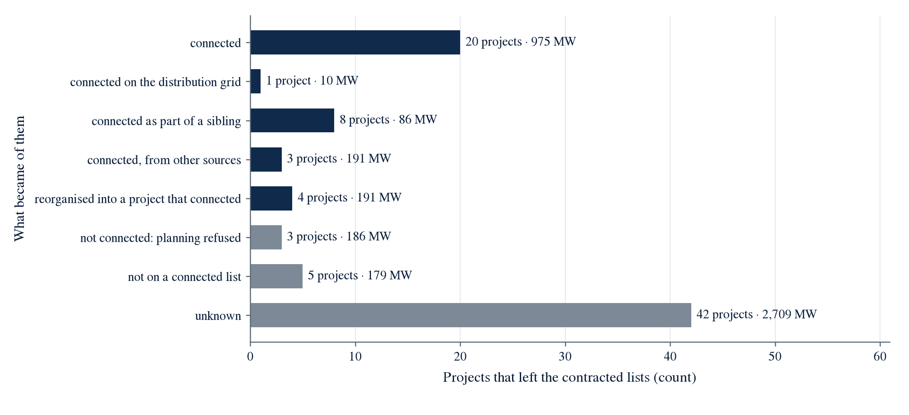

*Figure: 86 projects (4.53 GW) left for good: 36 connected one way or another, 42 unknown. Source: EirGrid contracted and connected lists, Supported by EirGrid Group Data; planning sources cited in src/iegrid/data/resolutions.csv; as of 2026-10-30.*

## What is stuck?

Three years after their results, 9.5% of the oldest batch's MW on the local grid was connected. No later batch has passed 1.1%.

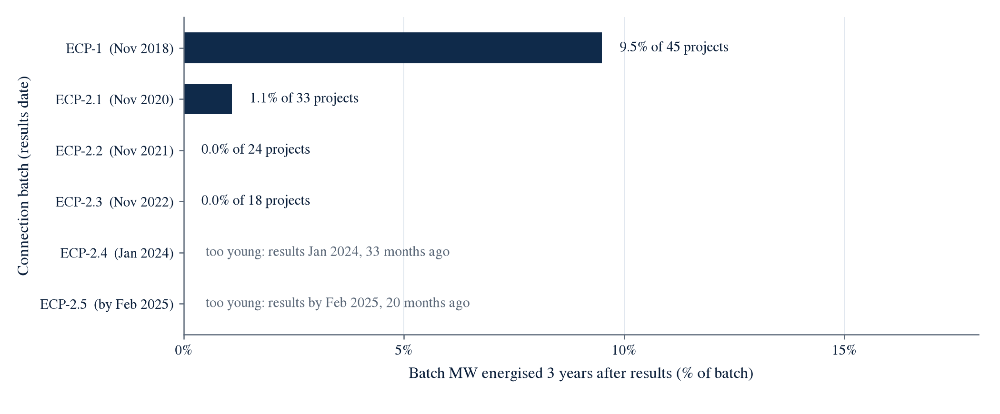

*Figure: ECP-1 had 10% of its distribution MW energised at that age; no later batch passed 1.1%. Source: ESB Networks DSO contracted and energised lists, © ESB Networks, used with their permission; as of 2026-08-05.*

Only part of each batch's offers ever reaches a list: 36% to 53% matching offer by offer, and 29% to 64% using the lists' own batch labels.

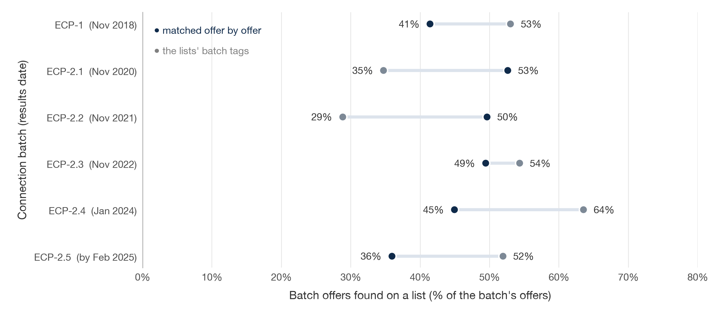

*Figure: 36% to 53% of what each batch offered has ever appeared on a list, by MW, using the offer-by-offer count. Source: ECP batch results publications; EirGrid contracted lists, Supported by EirGrid Group Data; ESB Networks DSO lists, © ESB Networks, used with their permission; as of 2026-10-30.*

## How fast does it get built?

These two charts show how much connects each year. Dividing the queue by that pace gives a sense of scale. At recent rates it comes to 18.3 years on the local grid and 20.6 for wind on the national grid. This isn't a forecast, because most contracted capacity never gets built.

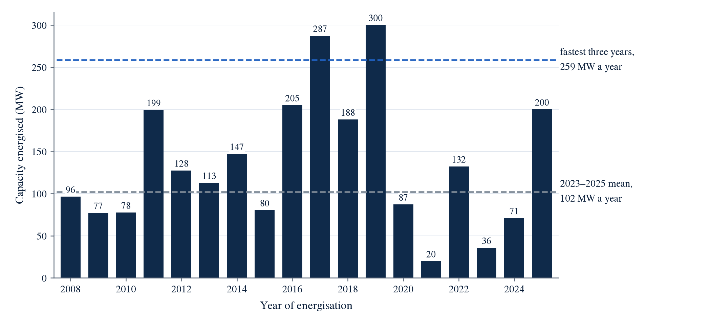

*Figure: At the 2023–2025 pace the 1.87 GW queue is 18.3 years of delivery; at the fastest three years (2017–2019), 7.2. Source: ESB Networks DSO energised lists, © ESB Networks, used with their permission; as of 2026-10-01.*

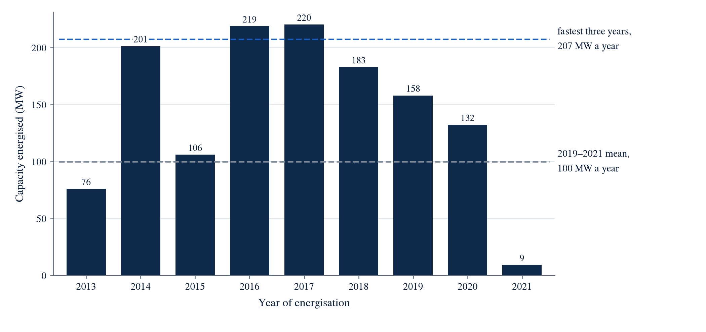

*Figure: At the 2019–2021 pace the 2.05 GW queue is 20.6 years of delivery; at the fastest three years (2016–2018), 9.9. Source: EirGrid connected wind lists, Supported by EirGrid Group Data; as of 2022-10-01.*

Of the 16 wind projects with a printed target month that we could follow, 15 connected late, by a median of 9.5 months.

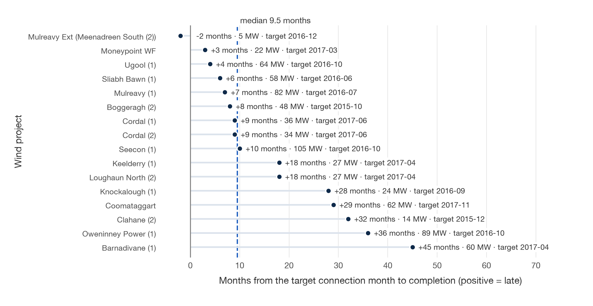

*Figure: 15 of 16 projects with a published target connected after it, by a median of 9.5 months. Source: EirGrid contracted and connected wind lists, Supported by EirGrid Group Data; as of 2026-10-30.*

## Where is it?

Each circle is a substation, sized by the capacity waiting there. The blue ones are 20 km or more from the main high-voltage network, and they hold 1.36 GW across 42 substations.

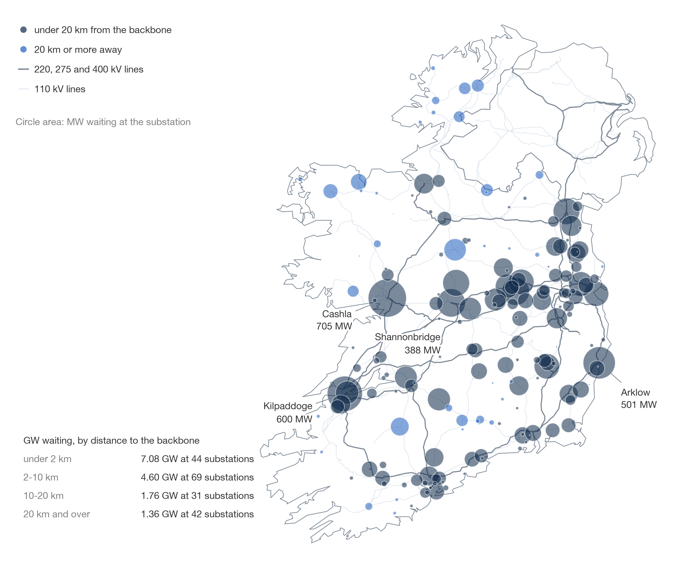

*Figure: 1.36 GW waits at 42 substations 20 km or more from the 220/275/400 kV network. Source: EirGrid contracted lists, Supported by EirGrid Group Data; ESB Networks DSO lists, © ESB Networks, used with their permission; lines and substations © OpenStreetMap contributors (ODbL), fetched 2026-10-28; transmission list as of 5 Aug 2026, distribution list as of 1 Oct 2026; as of 2026-10-01.*

*Grid lines, substations and county lookups: © OpenStreetMap contributors (ODbL).* *Lists: EirGrid Group Data and © ESB Networks, with permission.*

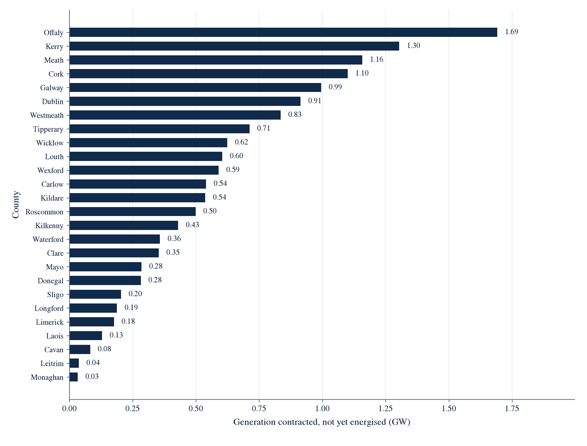

*Figure: Offaly holds the most, 1.69 GW; three counties hold 28% of what is placed. Source: EirGrid contracted lists, Supported by EirGrid Group Data; ESB Networks DSO lists, © ESB Networks, used with their permission; ECP results; substations © OpenStreetMap contributors (ODbL); transmission list as of 5 Aug 2026, distribution list as of 1 Oct 2026; as of 2026-10-01.*

*Grid lines, substations and county lookups: © OpenStreetMap contributors (ODbL).* *Lists: EirGrid Group Data and © ESB Networks, with permission.*

## How much of it can be relied on?

A wind or solar farm doesn't produce whenever it is needed, so the capacity auction counts it for less. Only a small share of wind, solar and battery capacity counts, compared with 77% of gas turbines. Gas makes up 56% to 59% of what counts.

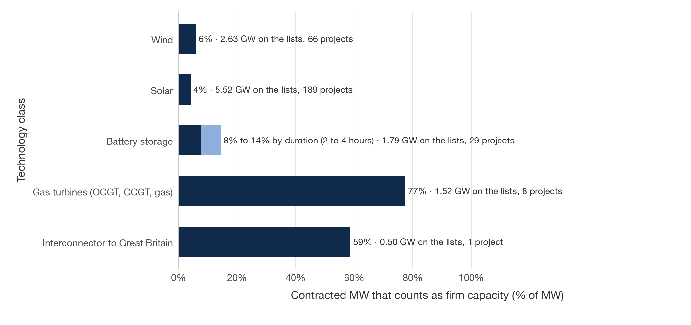

*Figure: 2.00 to 2.11 GW of the queue counts, and gas turbines are 56% to 59% of that. Source: EirGrid contracted lists, Supported by EirGrid Group Data; ESB Networks DSO lists, © ESB Networks, used with their permission; SEM capacity auction de-rating factors for 2030/31; transmission list as of 5 Aug 2026, distribution list as of 1 Oct 2026; as of 2026-10-01.*

The system's official plan, the adequacy assessment, expects 1,900 MW of new gas by 2030 and adds 660 MW of storage from 2026 to 2029. The lists hold 1,524 MW of gas turbines and 1,789 MW of batteries. The plan's shortfall in its cautious case is a fifth or less of what the queue counts for, so delivery is what matters.

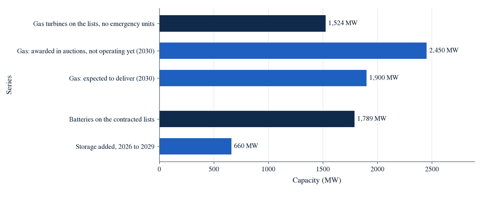

*Figure: The adequacy assessment expects 1,900 MW of new gas and adds 660 MW of storage; the lists hold 1,524 MW and 1,789 MW. Source: EirGrid and SONI, All-Island Resource Adequacy Assessment 2026-2035 (Ireland; data freeze 30 June 2025), read 2026-10-29; EirGrid contracted lists, Supported by EirGrid Group Data; ESB Networks DSO lists, © ESB Networks, used with their permission; transmission list as of 5 Aug 2026, distribution list as of 1 Oct 2026; as of 2026-10-01.*

The grid operators' reports can be scored against what happened. At least 307 MW of new conventional plant had arrived by the end of 2025. They had expected 310 to 530 MW, while the auctions had awarded 980 to 1,510 MW. So their expectations were much closer than the auction totals, though most still ran ahead of delivery. For the end of 2026 they need 495 to 793 MW more.

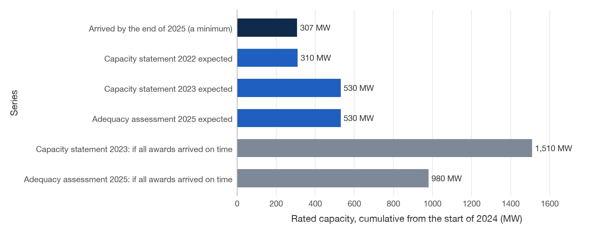

*Figure: At least 307 MW of new conventional plant had arrived by the end of 2025; the grid operators' reports expected 310 to 530 MW. Source: EirGrid and SONI capacity statements and adequacy assessments; EirGrid contracted lists, Supported by EirGrid Group Data; ESB Networks DSO lists, © ESB Networks, used with their permission; lists to 2026-10-01; as of 2026-10-01.*

## Can these numbers be trusted?

A list is only accepted once it agrees with itself: the same project references as the page text, and a total within 1 MW of the printed total. Every list keeps three dates: the date it describes, the date it went up and the date it was fetched.

As an outside check, the two companies' wind lists add up to within 3% of the national total published for the end of 2022.

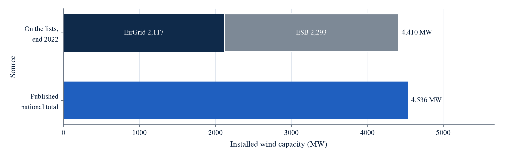

*Figure: The two publishers' lists add up to 4,410 MW against 4,536 MW published, 126 MW (2.8%) short. Source: EirGrid contracted lists, Supported by EirGrid Group Data; ESB Networks DSO lists, © ESB Networks, used with their permission: EirGrid connected wind list (2022-10-01) and ESB energised renewable list (2023-04-20); IEA Wind TCP Annual Report 2022, Ireland chapter by the national team. Checked 2026-10-29; as of 2026-10-29.*

EirGrid posts its lists about 5 days after the date they describe and ESB Networks about 28, so the local-grid side of any weekly report runs about a month behind.

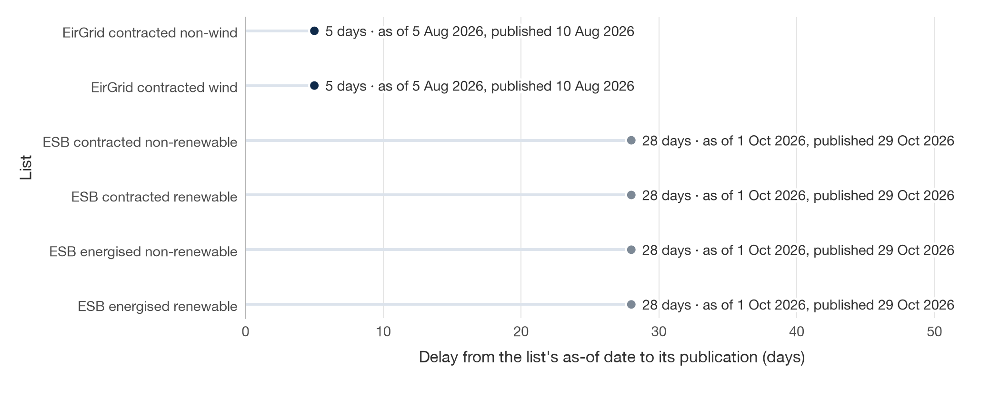

*Figure: EirGrid posts its lists about 5 days after their as-of date and ESB Networks about 28. Source: EirGrid contracted lists, Supported by EirGrid Group Data; ESB Networks DSO lists, © ESB Networks, used with their permission; as of 2026-10-30.*

## Running it

    uv sync
    ops/weekly.sh          # the weekly run: new lists in, report out, page rebuilt

Or step by step:

    uv run python -m iegrid.ingest         # fetch every current list into data/
    uv run python -m iegrid.load           # parse what is new, tied to the printed total
    uv run python -m iegrid.counties       # place projects in counties
    uv run python -m iegrid.grid           # OpenStreetMap lines and substations
    uv run python -m iegrid.report         # data/reports/<date>T<HHMM>.json and .pdf
    uv run python -m iegrid.readme_charts  # the charts above, into docs/img/ (.png, .pdf, .tex)
    uv run pytest

The dashboard is a static Next.js page built from the report and served locally:

    cd site && pnpm install && pnpm test && pnpm build && pnpm serve

## Layout

`src/iegrid/` is the code: ingest, parse, load, place, report, the charts, and the analysis layers. Small cited tables (stations, external checks, resolutions) live in `src/iegrid/data/`. `tests/` ties every edition to its printed total. `site/` is the dashboard, with tests that check every number on the page against the report. `ops/` is the weekly run. `data/` holds the raw PDFs, the DuckDB store and the reports, and is not in git.

Eleven further studies sit on top of the record in `docs/layers/`, each with its own README and tests: what became of the projects that left, delivery pace, target slippage, the offer-to-list funnel, where the lists disagree, ESB's older lists, the external check, sourced answers to open questions, firm capacity, the queue against the adequacy assessment, and a score of that assessment's own expectations. `docs/layers/00-decisions.md` says which were built, which were tried and dropped, and why. `docs/README.md` explains the rest of the documents and the stage numbering used in them.

## Data and licence

The code is MIT. The lists belong to their publishers; ESB Networks and EirGrid have each confirmed permission to use them here, the credit is given in the README next to the charts and in the `.tex` caption beside each image, and the full credits are in `NOTICE`. Grid lines and substations are © OpenStreetMap contributors (ODbL). The raw PDFs and the store are not redistributed.
