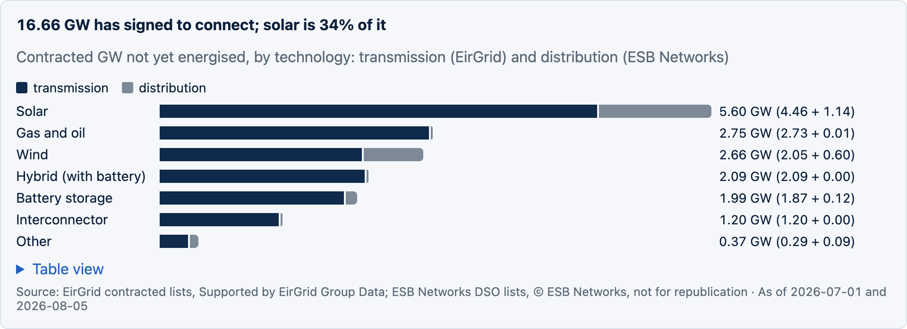
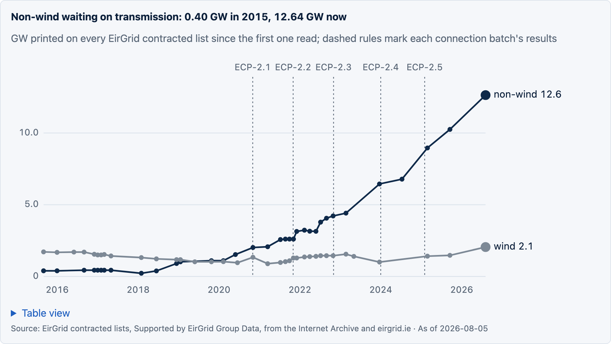
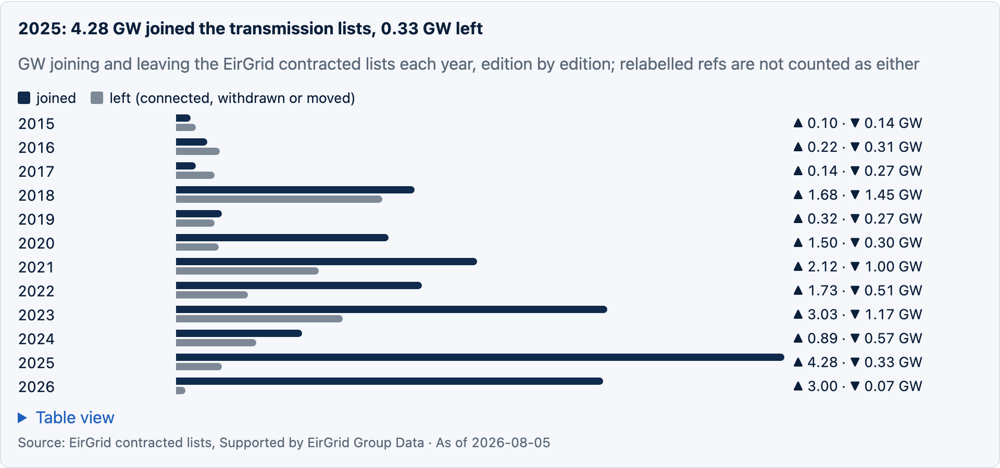
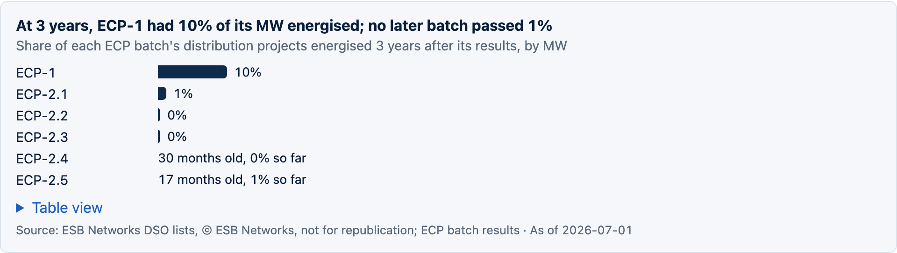
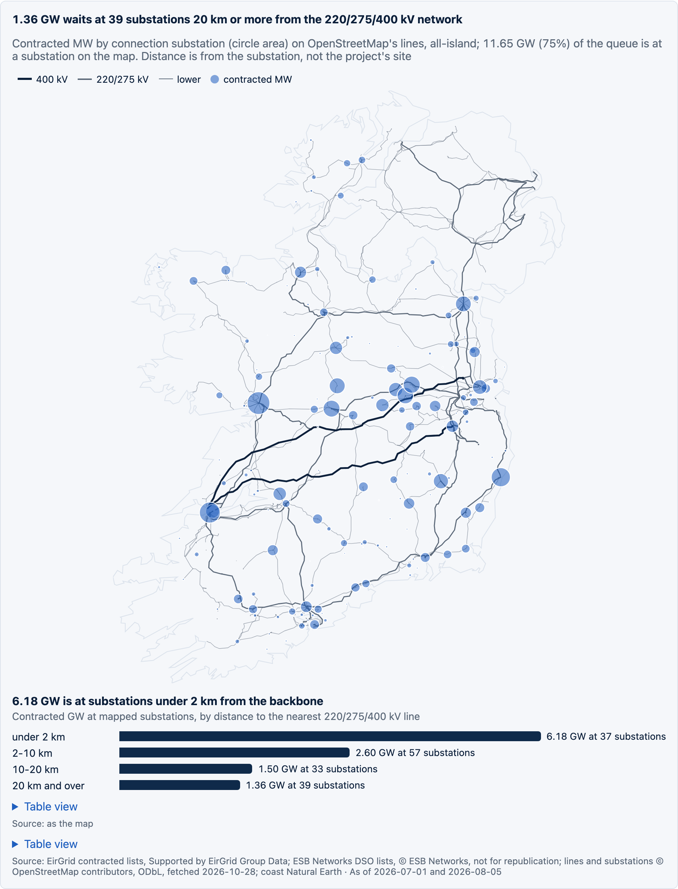
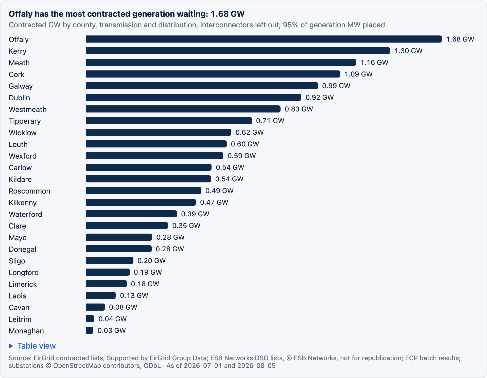
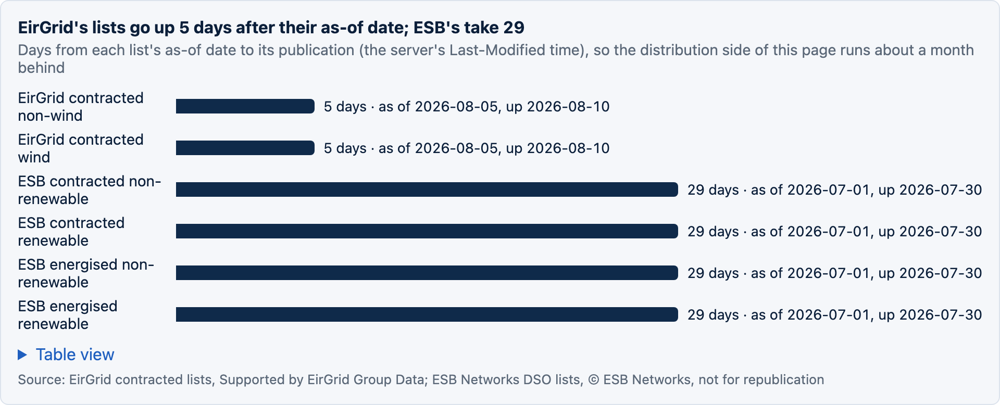

# ie-grid-pipeline

## Question

How much generation is waiting to connect to Ireland's grid, what moved this week, what is stuck, and where?

## Method

EirGrid (transmission) and ESB Networks (distribution) publish their contracted and energised project lists as PDFs. Each edition is kept as published, with its as-of date, publication time and ingest time. Archived editions back to 2015 come from the Wayback Machine. Each edition is parsed and loaded only if it ties to the list itself: the same refs as the page text and MW within 1 MW of the printed total. Projects are placed in counties from the ECP batch results, a cited table and OpenStreetMap substations. A weekly report (PDF and JSON) is built from the store, and a static page is built from the JSON. Every number on both is checked to come from the report. Details are in `docs/spec.md` and the open questions in `PARKING.md`.

## Result

From the report of 28 Oct 2026, with lists as of 5 Aug 2026 (transmission) and 1 Jul 2026 (distribution):
- 14.69 GW is contracted on transmission (158 projects) and 1.96 GW on distribution (177), not yet energised.
- Three years after its results, ECP-1 had 10% of its distribution MW energised; no later batch passed 1%.
- Offaly holds the most contracted generation (1.68 GW); 95% of generation MW is placed in a county.
- 1.36 GW waits at 39 substations 20 km or more from the all-island 220/275/400 kV network; 6.18 GW is under 2 km from it.

The charts below are from the dashboard (`site/`), each with its finding as the title.

**What is waiting.** Solar is a third of the 16.66 GW signed to connect, and non-wind on transmission grew from 0.40 GW in 2015 to 12.64 GW.

**What moved.** 2025 was the biggest year for joining: 4.28 GW joined the transmission lists and 0.33 GW left.

**What's stuck.** At equal age, the older batch connected faster: three years after its results ECP-1 had 10% of its distribution MW energised, and no later batch passed 1%.

**Where.** Each circle is a connection substation, sized by the MW waiting there, on OpenStreetMap's 110 kV and higher lines. 75% of contracted MW is at a substation OpenStreetMap names; the rest, mostly at new stations, is listed under the map.

**How fresh.** EirGrid posts its lists about 5 days after their as-of date and ESB about 29, so the distribution side runs a month behind.

## How to run

    uv sync
    uv run python -m iegrid.ingest     # fetch every current list into data/
    uv run python -m iegrid.grid       # OpenStreetMap lines and substations into data/osm (once, or to refresh)
    uv run python -m iegrid.report     # the weekly page: data/reports/<date>T<HHMM>.json and .pdf
    uv run pytest

    cd site && pnpm install
    pnpm test                          # every number on the page comes from the report
    pnpm build                         # static export of the newest report into site/out
    pnpm serve                         # http://127.0.0.1:3100, local only
    pnpm a11y                          # WCAG 2.2 AA, both modes, desktop and phone
    pnpm exhibit                       # screenshots into data/exhibits, charts into docs/img

The page is not published. ESB Networks' terms forbid republishing its lists without written permission (`PARKING.md`, licence).
