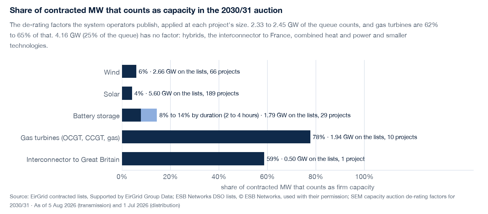

# Layer 9: how much of the queue counts as capacity

**What it adds.** 16.7 GW of contracted nameplate is the number every list prints. The Irish capacity
auction counts a unit by a de-rated MW: its size times a de-rating factor the system operators publish for
each auction. This layer counts the queue that way, from the factors themselves, so the page can say how
much of the queue would count and which technologies carry it.

**What it found** (lists of 5 Aug and 1 Jul 2026, factors of the 2030/31 auction):

| technology | contracted | counts, 2030/31 | share | counts, 2029/30 |
|---|---|---|---|---|
| wind | 2,656 MW | 157 MW | 6% | 167 MW |
| solar | 5,601 MW | 230 MW | 4% | 275 MW |
| battery storage (2 to 4 hours) | 1,789 MW | 139 to 257 MW | 8% to 14% | 254 to 493 MW |
| gas turbines (OCGT, CCGT, gas) | 1,944 MW | 1,511 MW | 78% | 1,560 MW |
| interconnector to Great Britain (Greenlink) | 504 MW | 296 MW | 59% | 266 MW |
| **with a factor** | **12,494 MW** | **2.33 to 2.45 GW** | | 2.52 to 2.76 GW |
| no factor applied | 4,164 MW | | | |

Gas turbines are 16% of the nameplate that has a factor and 62% to 65% of what counts. Between the two
auctions the factor for a battery fell by about half (a 4-hour battery of 100 MW: 0.275 to 0.143),
wind by 6% and solar by 16%: the more of a technology is built or contracted, the less each further MW counts.

## The six questions

1. **Build**: contracted MW by technology (the lists) times the de-rating factor for that technology and size
   (the SEM auction's Initial Auction Information Pack, Tables 1, 3 and 5), summed.
2. **Forecast**: none. It is the auction's rule applied to today's queue, not a forecast of what connects or of
   a future factor. The two auctions are shown to show how far the factors moved, not to extrapolate.
3. **Validate**: the factors are read out of the packs by code (`python -m iegrid.derating <pack.pdf>`), which
   refuses a curve with a gap or a factor outside 0 to 1, and a test re-reads the saved pack and compares every
   stored value. The contracted total it starts from ties to the lists' printed totals (the g2 parse gate). The
   sum is checked by hand-computed cases in `tests/test_derating.py`.
4. **Propose**: that the queue's capacity value is about an eighth of its nameplate, and mostly gas.
5. **Give**: the number a system planner or a developer reads, which no list prints, with every factor
   traceable to a page of a published document and the date it was read.
6. **Alpha**: no trading edge. It informs a reading of how much new capacity the market is signalling versus
   how much it will be paid for.

## What it applies, and what it leaves alone

Applied: wind and solar (Table 5, one factor each), gas turbines (Table 1's Gas Turbine curve at the
project's size), battery storage (Table 3, other storage, at 2 and at 4 hours), and the interconnector to Great
Britain (Table 1's Interconnector curve at its size). The factor is the pack's marginal factor for a unit of that
size, which is how the pack tells an applicant to use it. The pack's footnote says the interconnector curve to
Great Britain is already adjusted by an external-market factor (0.65 for 2030/31), so it is applied as printed;
the footnote's own arithmetic agrees (the 0-10 MW value of 0.625 is 0.65 of about 0.96, and 2029/30's 0.572 is
0.60 of about 0.95).

Left alone, and listed with its MW so nothing disappears: hybrids (solar plus battery, wind plus battery:
one MEC, and the pack gives no hybrid class, so any factor would be a guess), the Celtic interconnector to
France (the pack's footnote 3 says an interconnector to another EU state is expected to be non-participating
capacity in the 2030/31 auction, so it has no auction value, whatever the adequacy assessment counts), combined
heat and power, reciprocating engines, biomass, hydro, wave and synchronous condensers. That is 4.16 GW, 25% of
the queue, so the headline is about the 75% that has a factor. Which interconnector is to Great Britain is a
fact about the project's name, kept as one constant in `derating.py` (Greenlink: Wales; Celtic: France).

## Risks, and what was done about them

- **Duration.** The lists do not say how long a battery lasts. Both 2 and 4 hours are shown as a range, never one number.
- **Marginal factors.** They are the auction's price of an extra MW at the current system, and fall as more
  of a technology is built. Today's queue counted at today's factors is therefore generous to the
  technologies with a lot of contracted MW; that is why the two auctions are shown.
- **Wrong class.** A gas CCGT or a CHP unit may be qualified in a different class. CHP and engines are left
  out; OCGT, CCGT and "gas" are taken as gas turbines. A reader who knows a project's class can see which row it is in.
- **Reading a table off a PDF.** Done by code and re-checked by test against the pack, not by hand; a pack
  whose layout changes fails loudly rather than reading a wrong column.
- **Reading it as a forecast.** The page and this README say it is not one.

## What it doesn't prove

That the capacity will be built, that it will be awarded, what it will be paid, or what it delivers in a
given hour. It does not say whether Ireland needs the capacity: that needs EirGrid's capacity requirement and
the Generation Capacity Statement, which were not readable (`cms.eirgrid.ie` answers 403).

## Sources

SEM-O, *2029/2030 T-4 Capacity Auction Initial Auction Information Pack* IAIP2930T-4 v1.1 (13 Aug 2025) and
*2030/2031* IAIP3031T-4 v1.0 (4 Aug 2026), Tables 1, 3 and 5. URLs, pages and the date each was read are in
`src/iegrid/data/derating.csv`. The packs are saved in `data/sources/` (not in git).

*Built with the energy-analyst skill (see the main README).*

## Files

`src/iegrid/derating.py`, `src/iegrid/data/derating.csv`, `tests/test_derating.py`, the page's
"How much of the queue counts as capacity" section, `docs/img/firm.png`.
