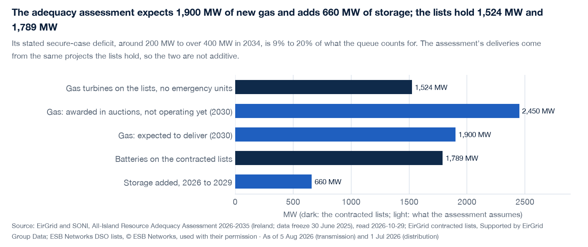

# Layer 10: the queue against the system's own plan

**What it adds.** Layer 9 said how much of the queue counts as capacity. This layer sets the queue against
the one official statement of what the system needs: EirGrid and SONI's *All-Island Resource Adequacy
Assessment 2026-2035* (AIRAA, the successor to the Generation Capacity Statement). It says how much new gas
and storage the assessment assumes is delivered, and how far the system sits from the reliability standard.
Those figures are read out of the document by code into `src/iegrid/data/adequacy.csv`, each row with its page
and the date it was read.

**What it found** (lists of 5 Aug and 1 Jul 2026; assessment with its data freeze of 30 June 2025):

| | the lists | the assessment |
|---|---|---|
| new gas | 1,944 MW of gas turbines (OCGT, CCGT, gas) | 2,450 MW successful in capacity auctions and not yet operating, of which 1,900 MW expected to deliver |
| storage | 1,789 MW of batteries | storage rises from 1,140 MW (2026) to 1,800 MW (2029): +660 MW, 37% of the battery queue |
| need | queue counts for 2.04 to 2.15 GW in the 2030/31 auction (layer 9) | outside the 3-hour standard in 2026-28 (base) and 2026-30 and 2033-35 (secure); stated secure deficit around 200 MW rising to over 400 MW in 2034 |

So the gas on the contracted lists is the size of the assessment's whole expectation for new gas (1.02 times),
and the assessment already assumes about a third of the battery queue arrives. The stated deficit, around 200
to over 400 MW, is 9% to 20% of what the queue counts for. Read plainly: the system's remaining gap is small
next to the queue, so how fast and how much of the queue converts, not its size, decides adequacy.

## The six questions

1. **Build**: the lists' technology totals (layer 9) against figures out of the assessment: Table 5.2
   (new conventional plant), Table 5.9 (storage), Tables 6.1, 6.2 and 6.5 (the standard and the hours of lost load
   a year, base and secure) and the executive summary's statement of the secure deficit.
2. **Forecast**: none of ours. The assessment's own expected deliveries are shown as its assumptions.
3. **Validate**: the extractor refuses a table whose storage rows do not add to their total (to the 10 MW the
   document rounds to) or whose expected delivery exceeds what was awarded, and a test re-reads the saved
   assessment and compares every stored value. The hours-outside-the-standard lists are computed from the
   table against the standard, and agree with the document's own statement that the secure case is briefly
   within the standard in 2031 and 2032.
4. **Propose**: that the queue is large against the stated need, so the open question is conversion.
5. **Give**: the first place the record meets an official need figure, with every number tied to a page.
6. **Alpha**: none directly; it frames how much of the signed queue the system operator already counts on.

## What it doesn't prove

- **The two are not additive.** The assessment's expected deliveries come from the same projects the lists hold
  (auction-successful plant is on the contracted lists). "1,944 MW of gas against 1,900 MW expected" is a match
  in size, not proof that the same plants are meant. The page says so.
- **37% is a reading, not a conversion rate.** It is the storage the plan adds divided by the battery queue.
  Some of the plan's 2026 storage may already be operating, and some of the queue is not in the plan.
- **The deficit is a stated range, not a table.** The document prints "around 200 MW increasing to over 400 MW in
  2034" in its summary and the year-by-year values only in a chart; this layer keeps the printed words and does
  not read a chart.
- **Variable generation is not compared.** The assessment's trajectory for wind and solar is a chart, and the
  Climate Action Plan targets are policy, not a forecast; neither is a number this layer will quote.
- The assessment is Ireland's; the all-island figures and Northern Ireland are left out.

## Sources

EirGrid and SONI, *All-Island Resource Adequacy Assessment 2026-2035* (Ireland chapter), data freeze 30 June
2025; the saved copy is in `data/sources/` (not in git). Pages and the date read are in the CSV.

*Built with the energy-analyst skill (see the main README).*

## Files

`src/iegrid/adequacy.py`, `src/iegrid/data/adequacy.csv`, `tests/test_adequacy.py`, the page's "The queue against
the system's own plan" section, `docs/img/plan.png`. The README chart for it (`readme_charts.py`) follows the
README PR.
